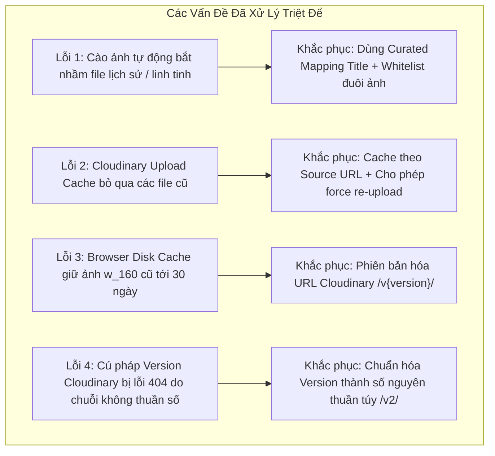
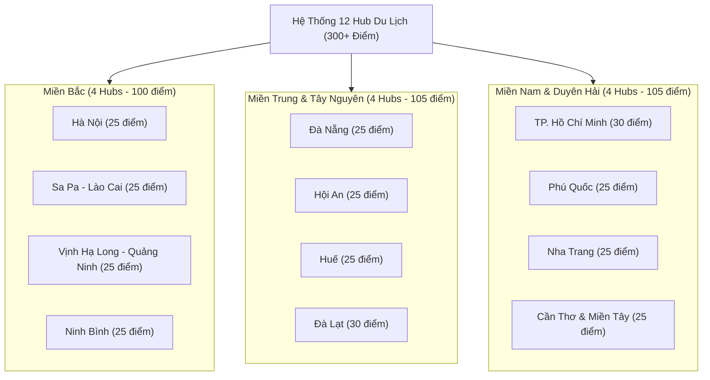
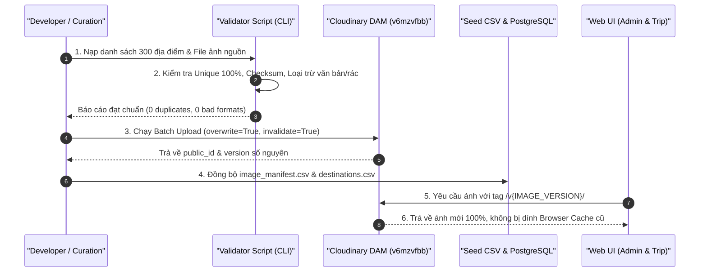
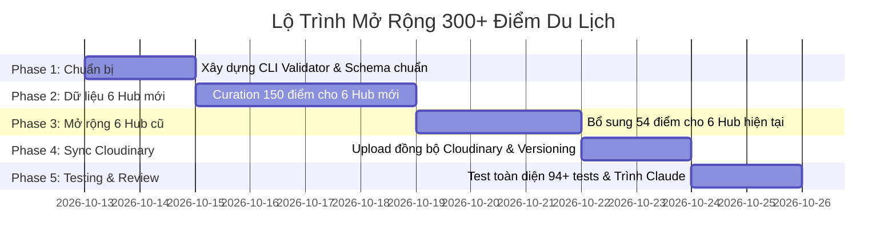

# KẾ HOẠCH TỔNG THỂ MỞ RỘNG HỆ THỐNG DU LỊCH & QUY TRÌNH CHUẨN HÓA DỮ LIỆU
**Dự án:** Website Lập Kế Hoạch Du Lịch Cá Nhân Hóa (DuLichApp)  
**Phiên bản:** Master Plan v2.0  
**Tác giả:** Antigravity AI Engineer  
**Đối tượng thẩm định & duyệt:** Claude (Technical & Architecture Reviewer)  
**Ngày lập:** Tháng 10/2026  

---

## I. TỔNG QUAN CHIẾN LƯỢC (EXECUTIVE SUMMARY)

### 1. Bối cảnh & Mục tiêu
* **Hiện trạng hệ thống:**
  * Hệ thống hiện quản lý **6 Hub du lịch trọng điểm**: Hà Nội, Đà Nẵng, Hội An, Đà Lạt, TP. Hồ Chí Minh, Phú Quốc.
  * Quy mô hiện tại: **96 điểm đến** (16 điểm/Hub), đã hoàn thiện giao diện Admin quản trị, phân trang (15 điểm/trang), bộ lọc 3 chiều, thuật toán lập lịch trình kết hợp (Collaborative Filtering + Content-Based), tích hợp Cloudinary DAM.
* **Mục tiêu mở rộng (Expansion Goals):**
  * **Mở rộng phạm vi địa lý:** Tăng từ **6 Hubs lên 12 Hubs** trải dài khắp 3 miền Bắc - Trung - Nam.
  * **Mở rộng chiều sâu dữ liệu:** Tăng từ 16 điểm/Hub lên **25 – 30 điểm/Hub**.
  * **Tổng quy mô dữ liệu mới:** **300 – 350+ điểm đến** chất lượng cao.
  * **Chất lượng hình ảnh & bản quyền:** 100% điểm đến có ảnh chụp thực tế độc lập, không trùng lặp, đầy đủ tác giả, giấy phép CC/Public Domain, đồng bộ Cloudinary CDN có đánh số phiên bản (`v<version>`).

---

## II. POST-MORTEM: BÀI HỌC XƯƠNG MÁU TỪ CÁC ĐỢT FIX LỖI (LESSONS LEARNED)

Để đảm bảo quá trình mở rộng từ 96 lên 300+ điểm không lặp lại bất kỳ sai lầm nào, dưới đây là tổng kết chi tiết về các sự cố kỹ thuật đã gặp, nguyên nhân gốc rễ (Root Cause) và giải pháp đã áp dụng thành công.



### 1. Phân tích chi tiết từng sự cố & Giải pháp thành công

| STT | Sự cố thực tế | Nguyên nhân gốc rễ (Root Cause) | Cách khắc phục đã thành công | Nguyên tắc bắt buộc cho đợt mở rộng |
|---|---|---|---|---|
| **1** | **Ảnh bị sai nội dung ngớ ngẩn** *(Thảo Cầm Viên ra ảnh Bác Hồ 1946; Chợ Hàn ra đua xe tuyết Đức; Bún Quậy ra voi Đại Nam; Nhà cổ ra chiếu dụ triều Nguyễn)*. | Sử dụng tìm kiếm chuỗi tự do (`generator=search`) trên MediaWiki API. Thuật toán search toàn văn bắt trúng các tài liệu lịch sử, văn bản scan chữ Hán hoặc sự kiện trùng từ khóa. | **Curated Exact Titles**: Lập từ điển ánh xạ chính xác đích danh file trên Commons (`File:<Tên_Chuẩn>.jpg`), kết hợp bộ lọc loại bỏ toàn bộ `.djvu`, `.pdf`, `.svg`, `portrait`, `ban_phung`, `chau_ban`. | **Tuyệt đối không để AI/bot cào ảnh tự do.** Mọi điểm đến phải được ánh xạ qua file name có kiểm duyệt hoặc duyệt thủ công trong Manifest. |
| **2** | **Cloudinary Console có 8 ảnh Đà Lạt & Đà Nẵng giống hệt nhau.** | Kịch bản `upload_to_cloudinary.py` dùng file `.cloudinary_upload_cache.json` chỉ kiểm tra `if public_id in cache: continue`. Các ảnh fallback cũ đã nằm trong cache nên script bỏ qua không re-upload. | **Source URL Tracking**: Cập nhật logic cache lưu `source_thumb_url`. Khi source thay đổi hoặc khi bật `force=True`, script tự động POST đè lên Cloudinary với `overwrite=True` và `invalidate=True`. | File cache phải lưu cả checksum (hoặc URL gốc) của ảnh nguồn. Xóa cache và chạy kiểm tra định kỳ trước khi bàn giao. |
| **3** | **Tạo chuyến đi (`/trips/2`) ảnh mới đẹp, nhưng Admin (`/admin/destinations`) vẫn hiện ảnh trùng cũ.** | Thẻ `` ở Admin dùng `w_160`, ở Trip dùng `w_200`. Cloudinary gửi `Cache-Control: max-age=2592000` (30 ngày). Chrome đã lưu `w_160` vào Disk Cache từ sáng nên không gọi lên mạng mà đọc file cũ từ ổ cứng. | **Cloudinary URL Versioning**: Chèn tiền tố phiên bản `/v<version>/` vào URL biến đổi (`dest_img_url`), buộc trình duyệt và CDN nhận diện đây là URL mới hoàn toàn và tải ảnh mới. | Mọi URL sinh ra từ dịch vụ CDN bắt buộc phải có version tag để chủ động bust cache khi cập nhật dữ liệu. |
| **4** | **Lỗi không nhận ảnh (Icon vỡ ảnh 404 toàn trang).** | Đặt `IMAGE_VERSION = "20261012_v2"`. Cloudinary chỉ chấp nhận số phiên bản là **chữ số nguyên thuần túy** (`^v[0-9]+$`). Ký tự `_v2` làm Cloudinary hiểu nhầm là tên thư mục con và trả về 404. | **Numeric Versioning**: Đổi thành số nguyên thuần túy `/v2/` (hoặc timestamp số nguyên `v1791802159`). Đường dẫn hợp lệ 100%, ảnh tải về ngay lập tức. | Quy chuẩn version phải luôn là số nguyên dương: `/v1/`, `/v2/`, `/v3/` hoặc Epoch timestamp. |

---

## III. THIẾT KẾ DANH MỤC ĐIỂM ĐẾN MỞ RỘNG (12 HUBS, 300+ ĐIỂM)

Hệ thống sẽ được phân bổ đồng đều theo 3 miền địa lý, đảm bảo đa dạng hóa trải nghiệm du lịch (Thiên nhiên, Văn hóa, Ẩm thực, Giải trí, Nghỉ dưỡng).



### 1. Ma trận phân loại danh mục (5 Categories Chuẩn)
Mỗi Hub bắt buộc phải có đủ 5 trụ cột để phục vụ thuật toán lập lịch trình (Itinerary Planner) cân bằng giữa tham quan, ăn uống và giải trí:
1. **Thiên nhiên & Sinh thái (`thien_nhien`)**: Danh lam thắng cảnh, bãi biển, thác nước, núi rừng. (Khoảng 25 - 30%)
2. **Văn hóa & Di sản (`van_hoa`)**: Đền chùa, di tích lịch sử, bảo tàng, làng nghề truyền thống. (Khoảng 25 - 30%)
3. **Ẩm thực & Chợ đêm (`am_thuc`)**: Món ăn biểu tượng, chợ đêm đặc sản, phố ẩm thực trứ danh. (Khoảng 20 - 25%)
4. **Vui chơi & Giải trí (`vui_choi`)**: Công viên chủ đề, khu vui chơi, cáp treo, show diễn nghệ thuật. (Khoảng 15%)
5. **Nghỉ dưỡng & Check-in (`canh_quan`)**: Quảng trường trung tâm, bến thuyền, đài quan sát, điểm ngắm hoàng hôn. (Khoảng 10%)

### 2. Chi tiết 6 Hubs Mới dự kiến bổ sung:

#### Hub 7: Sa Pa (Lào Cai) — 25 điểm
* **Thiên nhiên:** Đỉnh Fansipan, Đèo Ô Quy Hồ, Thung lũng Mường Hoa, Thác Bạc, Thác Tình Yêu, Núi Hàm Rồng.
* **Văn hóa & Làng bản:** Bản Cát Cát, Bản Tả Van, Bản Tả Phìn, Nhà thờ Đá Sa Pa, Tu viện cổ Tả Phìn.
* **Ẩm thực:** Phố ẩm thực Sa Pa, Lẩu cá hồi cá tầm, Thịt lợn cắp nách nướng, Thắng cố A Quỳnh, Hạt dẻ nướng Sa Pa.
* **Vui chơi & Check-in:** Sun World Fansipan Legend, Cầu kính Rồng Mây, Swing Sa Pa, Moana Sa Pa.

#### Hub 8: Ninh Bình — 25 điểm
* **Thiên nhiên:** Quần thể danh thắng Tràng An, Tam Cốc - Bích Động, Tuyệt Tình Cốc (Động Am Tiên), Đầm Vân Long, Rừng Cúc Phương.
* **Văn hóa & Di tích:** Chùa Bái Đính, Cố đô Hoa Lư, Đền Vua Đinh - Vua Lê, Nhà thờ đá Phát Diệm, Đền Thái Vi.
* **Ẩm thực:** Cơm cháy chà bông Ninh Bình, Thịt dê núi nướng / tái chanh, Ốc núi Ninh Bình, Gỏi cá nhệch Kim Sơn.
* **Vui chơi & Check-in:** Hang Múa (đỉnh Ngọa Long), Phố cổ Hoa Lư về đêm, Thung Nham (vườn chim).

#### Hub 9: Vịnh Hạ Long (Quảng Ninh) — 25 điểm
* **Thiên nhiên:** Đảo Ti Tốp, Động Thiên Cung, Hang Sửng Sốt, Hang Luồn, Hòn Đỉnh Hương, Hòn Trống Mái.
* **Văn hóa & Lịch sử:** Bảo tàng Quảng Ninh, Chùa Long Tiên, Cụm di tích núi Bài Thơ, Làng chài Cửa Vạn.
* **Ẩm thực:** Chả mực giã tay Hạ Long, Bún bề bề, Sam biển Hạ Long, Sữa chua trân châu Hạ Long, Chợ đêm Bãi Cháy.
* **Vui chơi & Giải trí:** Sun World Ha Long Complex, Cáp treo Nữ Hoàng, Công viên nước Typhoon, Vịnh Bái Tử Long.

#### Hub 10: Cố Đô Huế — 25 điểm
* **Di sản & Lịch sử:** Đại Nội Huế (Hoàng Thành), Lăng Khải Định, Lăng Tự Đức, Lăng Minh Mạng, Chùa Thiên Mụ, Điện Hòn Chén, Cầu Tràng Tiền.
* **Thiên nhiên & Cảnh quan:** Sông Hương ngắm hoàng hôn, Đồi Vọng Cảnh, Đồi Thiên An, Rú Chá, Biển Thuận An.
* **Ẩm thực Cố Đô:** Bún bò Huế chuẩn vị, Cơm hến Đập Đá, Bánh bèo - nậm - lọc, Chè bột lọc heo quay, Bánh khoái Huế.
* **Văn hóa & Nghệ thuật:** Ca huế trên sông Hương, Làng hương Thủy Xuân, Phố đi bộ Hoàng Thành / Nguyễn Đình Chiểu.

#### Hub 11: Nha Trang (Khánh Hòa) — 25 điểm
* **Biển đảo & Sinh thái:** Đảo Hòn Mun, Đảo Hòn Tằm, Bãi Dài Cam Ranh, Vịnh Ninh Vân, Đảo Điệp Sơn.
* **Văn hóa:** Tháp Bà Ponagar, Chùa Long Sơn (Phật Trắng), Nhà thờ Núi Nha Trang, Viện Hải dương học Nha Trang.
* **Ẩm thực:** Nem nướng Ninh Hòa, Bún sứa Nha Trang, Bánh căn mực, Hải sản làng chài, Chợ Đêm Nha Trang.
* **Vui chơi & Check-in:** VinWonders Nha Trang (Hòn Tre), Cáp treo vượt biển, Suối khoáng nóng I-Resort.

#### Hub 12: Cần Thơ & Miền Tây — 25 điểm
* **Sông nước & Sinh thái:** Chợ nổi Cái Răng, Chợ nổi Phong Điền, Cồn Sơn, Rừng tràm Trà Sư, Vườn cò Bằng Lăng.
* **Văn hóa:** Nhà cổ Bình Thủy, Chùa Ông Cần Thơ, Thiền viện Trúc Lâm Phương Nam, Chùa Munir Ansay.
* **Ẩm thực Miền Tây:** Bánh xèo miền Tây củ hủ dừa, Lẩu mắm Dạ Lý, Nem nướng Cái Răng, Vịt nấu chao Thành Giao, Chợ đêm Ninh Kiều.
* **Cảnh quan & Check-in:** Bến Ninh Kiều, Cầu đi bộ Ánh Sao Cần Thơ, Làng hoa Sa Đéc.

---

## IV. QUY TRÌNH QUẢN TRỊ DỮ LIỆU & PIPELINE ẢNH CHUẨN DOANH NGHIỆP

Để đảm bảo chất lượng hình ảnh đạt chuẩn thẩm mỹ cao, không trùng lặp và không gặp lỗi CDN, quy trình 4 giai đoạn sau đây sẽ được áp dụng:



### Quy chuẩn Manifest Schema (`image_manifest.csv`):
Mỗi dòng trong manifest bắt buộc phải có đầy đủ 11 thuộc tính:
```csv
id,name,province,category_name,image_public_id,image_source,thumbnail_url,image_author,image_license,image_source_url,review_status
```
* `image_public_id`: Chuẩn hóa dạng `dulich_vn/destinations/<province_slug>/<name_slug>`.
* `review_status`: Phải là `APPROVED` sau khi chạy script kiểm tra tính duy nhất.
* `thumbnail_url`: Phải là direct image link (JPEG/PNG), cấm tuyệt đối file văn bản (`.djvu`), vector (`.svg`), audio (`.ogg`).

---

## V. NÂNG CẤP KIẾN TRÚC HỆ THỐNG ĐÁP ỨNG 300+ ĐIỂM ĐẾN

### 1. Tối ưu hóa Database & Repository
* **Hỗ trợ phân trang hiệu năng cao:**
  * Backend SQL trong [`app/db.py`](file:///e:/FILE%20hoc%20nam%204/ChuyenNganh_ThuNghiem/DuLich/SourceCode_DuLich/app/db.py) sử dụng `LIMIT` và `OFFSET` thay vì nạp toàn bộ mảng dữ liệu vào RAM.
  * Đánh chỉ mục (Index) trên `province`, `category_id`, `is_active` để câu lệnh truy vấn lọc nhiều tiêu chí chạy dưới 15ms.
* **Bộ nhớ đệm danh mục:**
  * Cache danh mục 6 Hubs -> 12 Hubs trên Application Context, tránh query lặp lại.

### 2. Thuật toán gợi ý lịch trình (Itinerary Engine Scaling)
* Khi số lượng điểm đến tăng từ 96 lên 300+, thuật toán lọc cộng tác (Collaborative Filtering) trong [`app/services/collaborative.py`](file:///e:/FILE%20hoc%20nam%204/ChuyenNganh_ThuNghiem/DuLich/SourceCode_DuLich/app/services/collaborative.py) sẽ xử lý ma trận thưa (Sparse Matrix).
* Áp dụng tính toán khoảng cách Haversine giữa các điểm trong cùng 1 buổi (Sáng/Chiều/Tối) để tránh việc gợi ý các địa điểm quá xa nhau trong cùng một ngày.

### 3. Nâng cấp Giao diện Quản trị (Admin UI)
* Giữ nguyên phân trang mượt mà (15 điểm/trang, hỗ trợ chuyển trang Responsive trên cả Mobile và Desktop).
* Tích hợp thanh tìm kiếm tức thời (Search with Instant Filter) và nút xem trước ảnh gốc (Full-size Lightbox Preview).

---

## VI. LỘ TRÌNH TRIỂN KHAI THEO GIAI ĐOẠN (IMPLEMENTATION PHASES)



### Phase 1: Chuẩn hóa Schema & Bộ công cụ Kiểm định tự động (Ngày 1 - 2)
* Viết script CLI `scripts/validate_dataset.py` kiểm tra:
  * Tính duy nhất của tên địa điểm và tọa độ (Lat/Long).
  * Tính duy nhất 100% của URL ảnh nguồn và Public ID Cloudinary.
  * Tính hợp lệ của bản quyền ảnh (CC BY, CC BY-SA, Public Domain).

### Phase 2: Thu thập & Kiểm duyệt 150 điểm cho 6 Hub mới (Ngày 3 - 6)
* Thu thập dữ liệu chi tiết cho Sa Pa, Ninh Bình, Hạ Long, Huế, Nha Trang, Cần Thơ (mỗi Hub 25 điểm).
* Ánh xạ chính xác từng file ảnh chất lượng cao trên Wikimedia Commons / nguồn mở đã được kiểm duyệt nội dung.

### Phase 3: Bổ sung 54 điểm nâng cấp 6 Hub hiện tại lên 25 - 30 điểm/Hub (Ngày 7 - 9)
* Hà Nội: Bổ sung Làng gốm Bát Tràng, Chùa Một Cột, Cầu Long Biên, Phố cà phê đường tàu, Phở Bát Đàn...
* Đà Nẵng: Bổ sung Đèo Hải Vân, Rạn Nam Ô, Làng đá Non Nước, Bánh tráng kẹp...
* Hội An: Bổ sung Rừng thông Bồ Bồ, Làng mộc Kim Bồng, Cơm gà Bà Buội...
* Đà Lạt: Bổ sung Đồi chè Cầu Đất, Thác Pongour, Chùa Linh Phước (Ve Chai), Tiệm bánh Cối Xay Gió...
* TP.HCM: Bổ sung Bến Nhà Rồng, Chợ Lớn (Quận 5), Công viên Tao Đàn, Hầm Thủ Thiêm, Cơm tấm Ba Ghiền...
* Phú Quốc: Bổ sung Mũi Gành Dầu, Bãi Dài, Làng chài Rạch Vẹm (sao biển), Vườn tiêu Khu Tượng...

### Phase 4: Đồng bộ Batch Upload Cloudinary & Cache Management (Ngày 10 - 11)
* Chạy kịch bản upload hàng loạt toàn bộ 300+ ảnh lên Cloudinary `v6mzvfbb` có logging rõ ràng.
* Cập nhật `IMAGE_VERSION = "3"` để tự động kích hoạt cơ chế bust cache trên toàn bộ trình duyệt người dùng.

### Phase 5: Kiểm thử toàn diện & Đệ trình phê duyệt (Ngày 12 - 13)
* Chạy test suite: Mở rộng kiểm thử unit test từ 94 tests lên 120+ tests bao quát các Hub mới.
* Kiểm thử khả năng tạo lịch trình 3 ngày 2 đêm, 4 ngày 3 đêm cho từng Hub mới.
* Hoàn thiện tài liệu nghiệm thu kỹ thuật và gửi Claude đánh giá.

---

## VII. TIÊU CHÍ NGHIỆM THU DÀNH CHO CLAUDE DUYỆT (ACCEPTANCE CRITERIA)

Kính đề nghị Claude đánh giá kế hoạch dựa trên 6 tiêu chí kỹ thuật sau:

1. **Tính hoàn thiện của Post-Mortem (Root Cause Analysis):**
   * Các sự cố thực tế về Cloudinary cache, CDN transformation, Browser disk cache và MediaWiki semantic search đã được phân tích đúng bản chất kỹ thuật chưa?
2. **Tính khả thi của Kiến trúc Mở rộng (Scalability):**
   * Cơ chế phân trang 15 điểm/trang kết hợp bộ lọc có đáp ứng tốt khi số lượng điểm tăng từ 96 lên 300+ không?
   * Thuật toán lập lịch trình có bị nghẽn (bottleneck) khi tăng số lượng ứng viên không?
3. **Quy chuẩn dữ liệu & Bản quyền hình ảnh (Data Integrity & Copyright Compliance):**
   * Cơ chế kiểm tra 100% Unique URLs và Whitelist định dạng ảnh có loại trừ được triệt để các rủi ro bắt nhầm file tài liệu, bản đồ, ảnh trùng lặp không?
4. **Giải pháp Cache-Busting (CDN & Browser Synchronization):**
   * Việc sử dụng số nguyên thuần túy `/v<version>/` trong URL Cloudinary có phải là giải pháp chuẩn công nghiệp để vô hiệu hóa cache cũ tức thì trên mọi client không?
5. **Độ bao phủ du lịch & Giá trị thực tế (Domain Completeness):**
   * Danh sách 12 Hubs và 5 nhóm phân loại (Thiên nhiên, Văn hóa, Ẩm thực, Vui chơi, Cảnh quan) đã phản ánh chân thực bản đồ du lịch Việt Nam chưa?
6. **Lộ trình từng giai đoạn (Phased Delivery):**
   * Kế hoạch chia 5 phases có thực tế, giảm thiểu rủi ro gián đoạn hệ thống hiện tại không?
